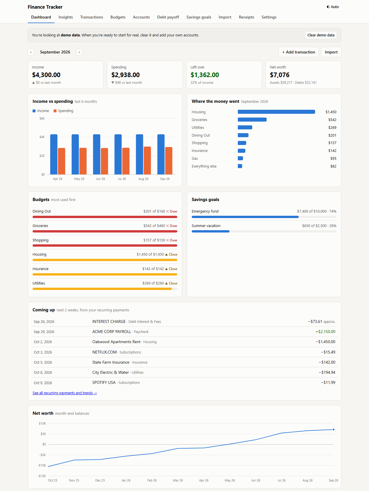
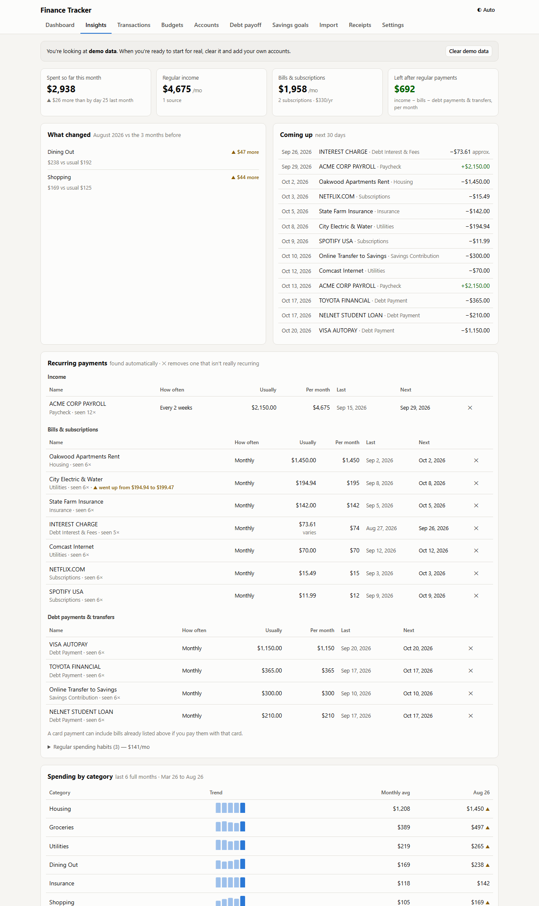
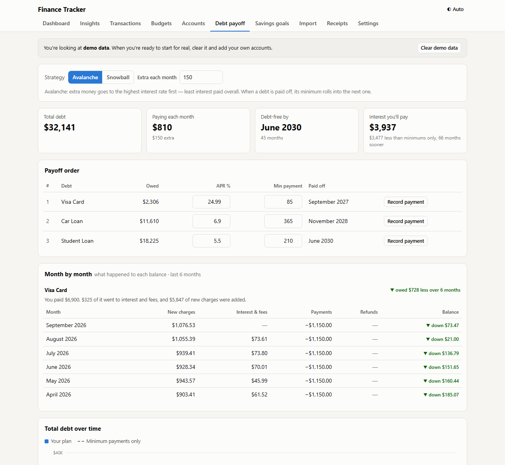
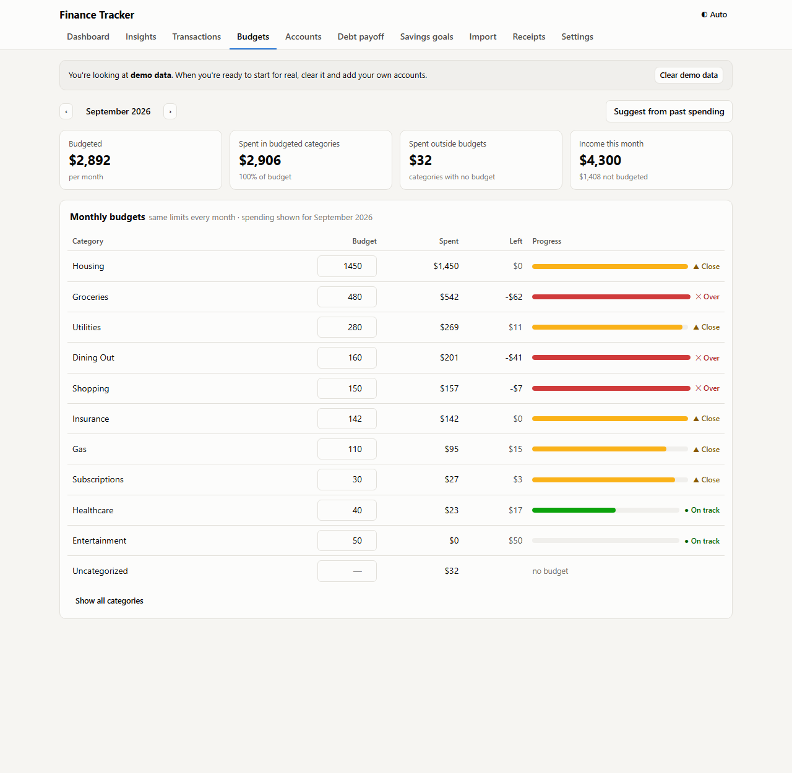

# Finance Tracker

A private, local-first personal finance app in a single HTML file. It needs no installation, no server and no account, and your data never leaves your computer.

**[Live demo with sample data →](https://TekBuilds26.github.io/finance-tracker/?demo)**

Built with AI-assisted development (Claude Code). I acted as product owner and tester: I defined the requirements, validated every feature against real bank exports and receipts, and drove each fix from issues found in real data. See [CASE_STUDY.md](CASE_STUDY.md) for the full story.

## What it does

| Area | Features |
|---|---|
| **Import** | Bank CSVs (auto-detects columns, remembers each bank's layout), PDF statements, many files at once, duplicate detection, bank-specific cleanup (Chase ACH strings, Capital One debit/credit columns, card purchase dates) |
| **Receipts** | Emailed receipts (.eml), PDFs, photos/screenshots (OCR), pasted text. Reads store, date, total, tax and line items, then links each receipt to its bank transaction automatically |
| **Categorization** | Keyword rules with optional amount ranges, bank-provided categories as fallback, split transactions, learns from your corrections |
| **Insights** | Detects recurring income, bills and subscriptions; flags price increases and cancelled services; month-over-month changes; spending by weekday; item-level search across receipts ("how much do we spend on soda?") |
| **Budgets & goals** | Monthly category budgets with status labels, savings goals with required monthly pace |
| **Debt payoff** | Avalanche vs. snowball simulation, debt-free date, interest saved, and a per-card monthly breakdown of charges vs. interest vs. payments |
| **Data safety** | Autosave to a JSON file you choose, backup/restore (optionally including receipt files), non-destructive data migrations between versions |

| Insights | Debt payoff | Budgets |
|---|---|---|
|  |  |  |

## Run it

Download `index.html` and open it in Chrome or Edge. That's it.

- Click **Explore with demo data** to look around, or open `index.html?demo`.
- Your data is stored in the browser. Use **Settings → Autosave to a file** to keep a master copy in a folder you choose (e.g. OneDrive).
- PDF reading ([pdf.js](https://mozilla.github.io/pdf.js/)) and photo OCR ([Tesseract.js](https://tesseract.projectnaptha.com/)) load from a CDN only when you use those features. Everything else works offline.

## Design decisions

- **Local-first and private.** Financial data is sensitive. Nothing is uploaded; files are parsed in the browser.
- **Single file, zero dependencies to install.** Easy to run, audit and hand to someone else.
- **Transparent automation.** Every import and receipt goes through a preview you can correct before anything is saved.
- **Safe upgrades.** Versioned migrations update categories and rules in existing data without undoing the user's own changes.

## Tech

Vanilla JavaScript, HTML and CSS; SVG charts drawn by hand; `localStorage` + IndexedDB + the File System Access API for storage; pdf.js and Tesseract.js loaded on demand.
